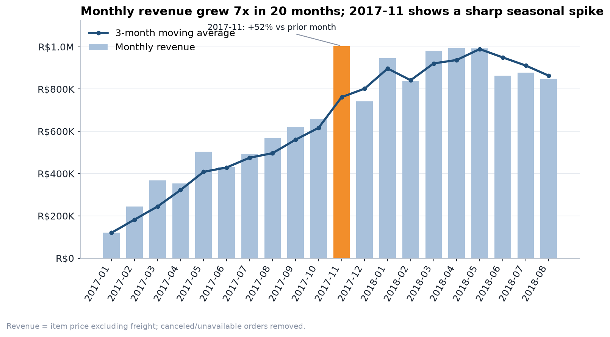
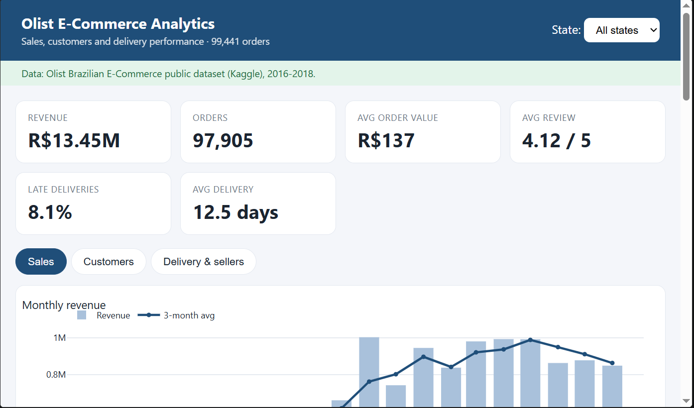
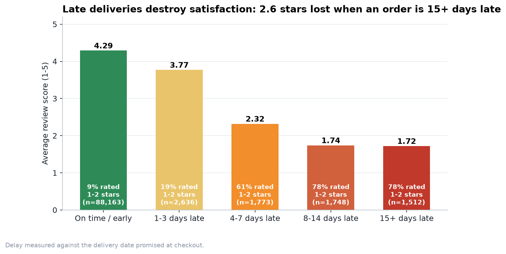
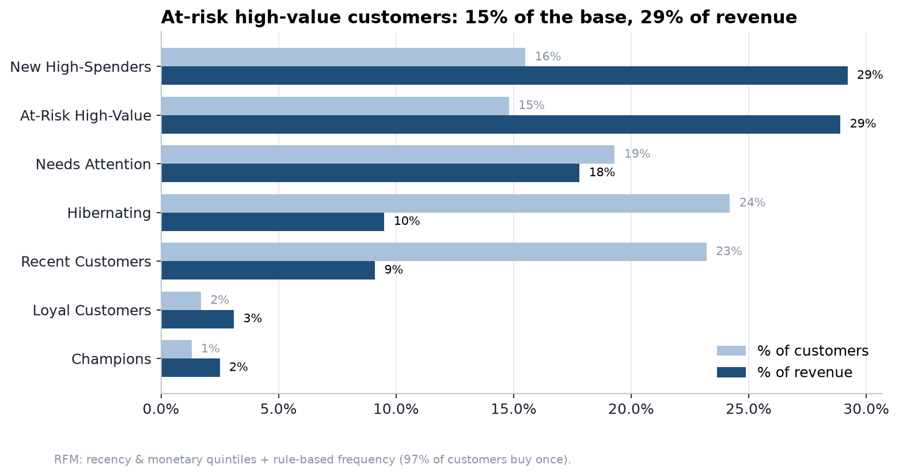
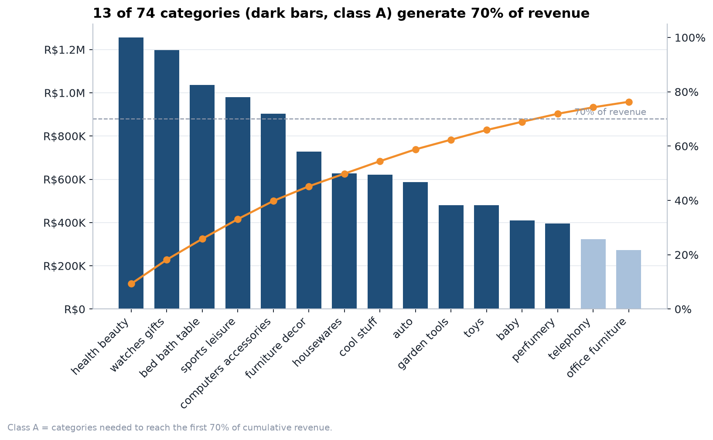
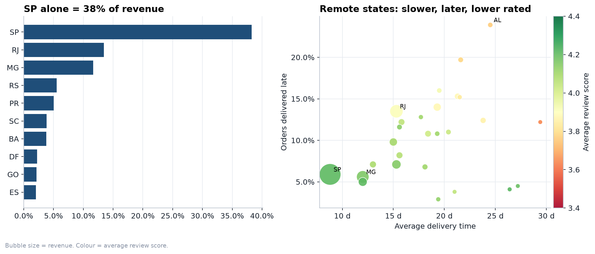
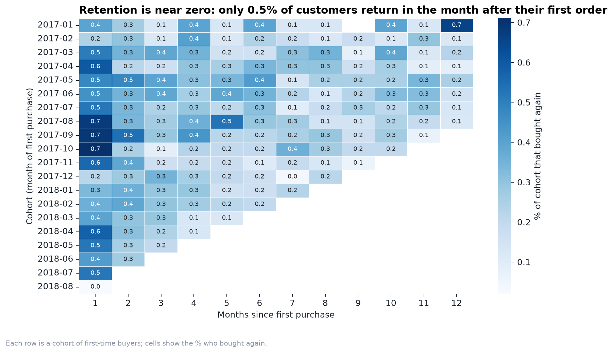
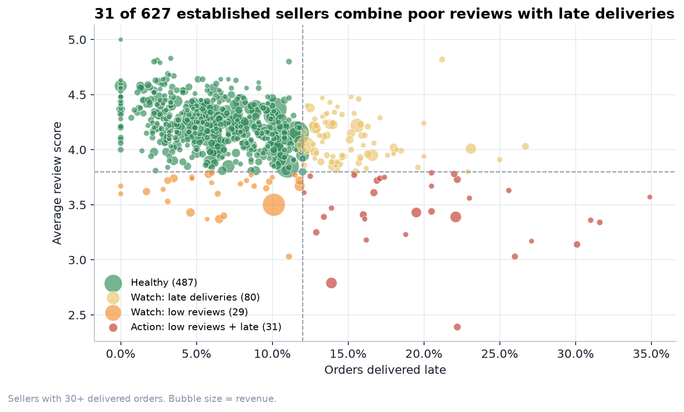

# Olist E-Commerce Analytics: SQL, Python and Dashboard

End-to-end data analysis of a Brazilian online marketplace: from raw relational data to SQL analysis, statistical testing, customer segmentation and an interactive dashboard, finishing with business recommendations.

**Tools:** SQL (SQLite) · Python (pandas, SciPy, scikit-learn) · Matplotlib / Seaborn / Plotly · Jupyter · pytest · Power BI / Tableau-ready exports

**Live dashboard:** https://kevin-sampath-y.github.io/olist-ecommerce-analytics/



---

## Business problem

An online marketplace connecting small sellers to customers across Brazil wants to know:

1. How is revenue trending, and which categories and regions drive it?
2. How much does **late delivery** hurt customer satisfaction?
3. Who are the most valuable customers, and who is about to be lost?
4. Do customers come back? Which sellers need intervention?

## Dataset

[Olist Brazilian E-Commerce Public Dataset](https://www.kaggle.com/datasets/olistbr/brazilian-ecommerce) (Kaggle): ~100k orders from 2016 to 2018 across 9 relational tables (orders, items, payments, reviews, customers, sellers, products, geolocation, category translation).

## Key findings

<!-- INSIGHTS:START -->
> Figures below were computed on the public **Olist Brazilian E-Commerce** dataset.


### Headline metrics

| Metric | Value |
|---|---|
| Orders analysed | 98,199 |
| Unique customers | 94,983 |
| Revenue (excl. freight) | R$13.49M |
| Average order value | R$137 |
| Average review score | 4.12 / 5 |
| Late deliveries | 8.1% |
| Average delivery time | 12.6 days |
| Customers who ordered more than once | 3.0% |

### Key findings

1. **Strong growth with a seasonal spike.** Monthly revenue grew about 7x over 20 months; 2017-11 jumped 52% over the previous month, and the highest month was 2017-11 (R$1.00M).
2. **Revenue is concentrated.** 13 of 74 categories deliver 70% of revenue (largest: *health beauty*, 9.3%), and state **SP** alone accounts for 38% of revenue.
3. **Late delivery is the clearest driver of unhappy customers.** On-time orders average 4.29 stars; orders delivered 15+ days late average 1.72, and 78% of them get 1-2 stars. Late orders score 1.73 stars lower on average (95% bootstrap CI -1.76 to -1.69; Mann-Whitney p < 0.001).
4. **Retention is the biggest untapped opportunity.** Only 3.0% of customers ever buy twice and 0.45% return in the month after their first order. Repeat buyers generate 3.1% of revenue in the last six months.
5. **High-value customers are drifting away.** The *At-Risk High-Value* RFM segment is 15% of customers but 29% of historical revenue; true *Champions* are only 1.3% of customers.
6. **Geography drives service quality.** *AL* has the highest late rate among states with 100+ orders (24%), and *MA* has the heaviest freight burden (26% of item value).
7. **Seller quality is uneven.** 31 of 627 established sellers have both poor reviews and late deliveries.
8. **Payments.** Credit cards carry 78% of payment value with an average of 3.5 instalments.
9. **Driver model.** A class-balanced logistic regression flags bad reviews with ROC-AUC 0.73; the strongest predictor is *total delivery time (days)* (odds ratio 1.82 per standard deviation). This is association, not proof of causation.

### Recommendations

- **Reset delivery promises** for slow regions such as AL: under-promise and over-deliver to protect review scores.
- **Run a seller improvement programme** starting with the 31 sellers flagged *Action* in the scorecard.
- **Launch a win-back campaign** (coupon or free shipping) for the At-Risk High-Value segment, and a post-purchase journey to lift second-order rate.
- **Plan capacity ahead of seasonal peaks** (the 2017-11 spike, +52% in one month) to keep delivery times flat.
- **Test free-shipping thresholds** in high-freight states (MA) to lift conversion.

### Data validation

- PASS: Revenue (SQL vs pandas) (SQL 13,494,400.74 vs pandas 13,494,400.74)
- PASS: Valid orders (SQL 98,199 vs pandas 98,199)
- PASS: Unique customers (SQL 94,983 vs pandas 94,983)
- PASS: Late delivery % (SQL 8.11 vs pandas 8.11)
- PASS: RFM customers (view vs unique customers) (SQL 94,983 vs pandas 94,983)

<!-- INSIGHTS:END -->

## Visual highlights

| | |
|---|---|
|  |  |
|  |  |
|  |  |

**Interactive dashboard:** open `reports/dashboard.html` in a browser (state filter, three tabs, hover details). To host it free, enable GitHub Pages on the `reports/` folder.

## What this project demonstrates

| Skill | Where |
|---|---|
| Relational modelling, constraints, indexes | `sql/01_schema.sql` |
| Reusable views, single source of truth for metrics | `sql/02_views.sql` |
| CTEs, window functions (`LAG`, `RANK`, `NTILE`, `ROW_NUMBER`, running totals), conditional aggregation | `sql/03_*.sql` to `sql/05_*.sql` |
| Customer segmentation (RFM) adapted to a skewed dataset | `sql/04_customer_analytics.sql` |
| Cohort retention analysis | `sql/04_customer_analytics.sql` |
| Data quality checks and cleaning decisions | `notebooks/01_eda_and_analysis.ipynb` |
| Hypothesis testing (Mann-Whitney, bootstrap CI, effect size) | `src/analysis.py` |
| Predictive/explanatory modelling (logistic regression, odds ratios, ROC-AUC) | `src/analysis.py` |
| Validating SQL against an independent pandas calculation | `src/analysis.py` (`cross_check`) |
| Data storytelling: action titles, annotated charts | `src/charts.py` |
| Interactive dashboard | `src/dashboard.py` |
| Automated tests | `tests/test_pipeline.py` |
| Reproducible one-command pipeline | `run_pipeline.py` |

## Project structure

```
olist-ecommerce-analytics/
├── data/
│   ├── raw/                  # Olist CSVs go here (not committed)
│   └── processed/            # SQL query results + BI exports
├── sql/                      # schema, views, analysis queries
├── src/                      # pipeline code (database, analysis, charts, dashboard, report)
├── notebooks/                # executed walkthrough notebook
├── reports/                  # dashboard.html, insights.md, figures/
├── docs/                     # replication, Power BI and resume guides
├── tests/                    # pytest suite
├── run_pipeline.py           # run everything
└── requirements.txt
```

## How to run

```bash
git clone https://github.com/<your-username>/olist-ecommerce-analytics.git
cd olist-ecommerce-analytics
python -m venv .venv && source .venv/bin/activate      # Windows: .venv\Scripts\activate
pip install -r requirements.txt
```

**Using the real data (recommended):** download the dataset from [Kaggle](https://www.kaggle.com/datasets/olistbr/brazilian-ecommerce), unzip the 9 CSV files into `data/raw/`, then:

```bash
python run_pipeline.py
```

**No Kaggle account yet?** Generate demo data with the same schema:

```bash
python run_pipeline.py --synthetic
```

Outputs: `reports/dashboard.html`, `reports/insights.md`, `reports/figures/*.png`, `data/processed/bi/*.csv`. Run the tests with `pytest -q`.

## Metric definitions

- **Revenue** = sum of item prices (freight excluded) for orders not canceled or unavailable.
- **Late order** = delivered after the estimated delivery date shown at checkout.
- **Customer** = `customer_unique_id` (`customer_id` is generated per order in this dataset, a classic pitfall).
- **RFM**: recency and monetary scored in quintiles; frequency scored by rule (1, 2, 3+ orders) because ~97% of customers buy once.
- Analysis window: 2017-01 to 2018-08 (other months are incomplete in the source data).

## Limitations

- Observational data: review-score drivers show association, not causation.
- No marketing, cost or margin data, so profitability and ROI are out of scope.
- One-time buyers dominate, so retention conclusions rest on a small repeat-purchase sample.

## Next steps

- Customer lifetime value (BG/NBD) and a repeat-purchase propensity model.
- Review text analysis (Portuguese NLP) to find root causes of low scores.
- Delivery-time prediction to set better promised dates.

## Author

**Kevin** · [LinkedIn](https://www.linkedin.com/in/kevin-sampath-y) · [GitHub](https://github.com/Kevin-Sampath-Y)

Data: Olist, released under CC BY-NC-SA 4.0. Code: MIT.
